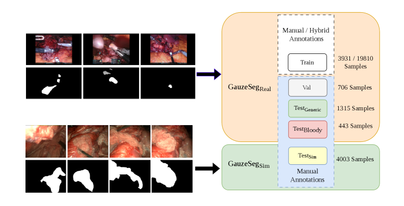
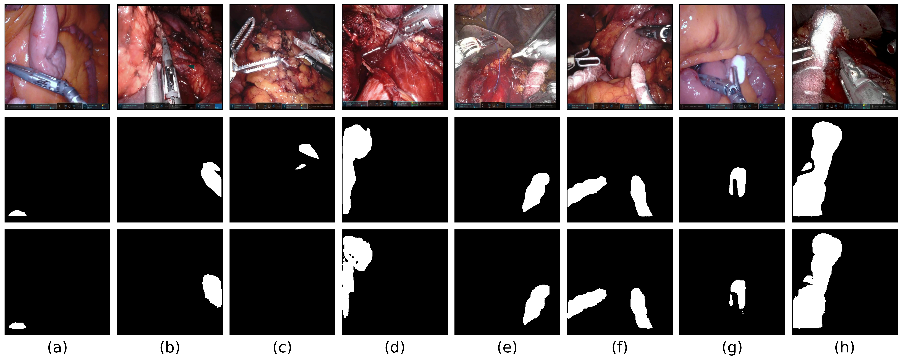

# GauzeSeg

Training code for intraoperative gauze segmentation in minimally invasive abdominal surgery (GauzeSeg<sub>Real</sub>).

**Paper:** [arXiv:2607.29132](https://arxiv.org/pdf/2607.29132) · [IEEE DSAA 2025](https://doi.org/10.1109/DSAA65442.2025.11248028)

## Workflow



*Overview of GauzeSeg<sub>Real</sub> (top) and GauzeSeg<sub>Sim</sub> (bottom) with sample images and masks. GauzeSeg<sub>Real</sub> uses manual and hybrid (manual + auto-tracked) annotations, split by patient ID into train, validation, and test sets (Test<sub>Generic</sub>, Test<sub>Bloody</sub>). GauzeSeg<sub>Sim</sub> is used as an out-of-distribution test set (Test<sub>Sim</sub>). Evaluation splits use only manual annotations.*

## Models

| Type | Architectures |
|---|---|
| CNN | U-Net, DeepLab (ResNet-50), Attention U-Net |
| Transformer | SegFormer (MiT-b1, MiT-b3), Mask2Former |
| Hybrid | TransU-Net |

Pretrained variants (`SegFormer_pt`, `Mask2Former_pt`, `DeepLab_pt`) are supported via config. SAM and nnU-Net stubs are included for extension.

## Results



*Qualitative results of SegFormer-b3<sub>pt</sub> trained on hybrid annotations. Each panel shows input (top), ground truth (middle), and prediction (bottom) for Test<sub>Generic</sub>, Test<sub>Bloody</sub>, and Test<sub>Sim</sub>.*

## Setup

```bash
pip install -e .
pip install -r requirements.txt
```

Place datasets under `./data` (e.g. `dV_Pankreas_pseudonymisiert_cut/`, `manual_annotations/`). Simulated Zenodo test data: `./data/zenodo`. Logs and checkpoints default to `./results/`.

## Training

```bash
python scripts/trainer.py -c configs/manual_anno/config_unet_manual.yaml
```

Configs: `configs/manual_anno/`, `configs/mix_anno/`, `configs/manual_anno/crop_anno/`.

## Citation

If you use this code, please cite:

> Priya Tomar, Maximilian Broß, Philipp Feodorovici, Jan Arensmeyer, Philipp Leifels, Aditya Parikh, Hanno Matthaei, Christian Bauckhage, Helen Schneider, and Rafet Sifa. *First Investigation of Deep Learning for Intraoperative Gauze Segmentation in Minimally Invasive Abdominal Surgery.* IEEE 12th International Conference on Data Science and Advanced Analytics (DSAA), 2025. [arXiv:2607.29132](https://arxiv.org/pdf/2607.29132) · [DOI: 10.1109/DSAA65442.2025.11248028](https://doi.org/10.1109/DSAA65442.2025.11248028)

```bibtex
@inproceedings{tomar2025gauzeseg,
  title={First Investigation of Deep Learning for Intraoperative Gauze Segmentation in Minimally Invasive Abdominal Surgery},
  author={Tomar, Priya and Bro{\ss}, Maximilian and Feodorovici, Philipp and Arensmeyer, Jan and Leifels, Philipp and Parikh, Aditya and Matthaei, Hanno and Bauckhage, Christian and Schneider, Helen and Sifa, Rafet},
  booktitle={2025 IEEE 12th International Conference on Data Science and Advanced Analytics (DSAA)},
  year={2025},
  doi={10.1109/DSAA65442.2025.11248028}
}
```

## License

This project is licensed under the MIT License — see [LICENSE](LICENSE).
